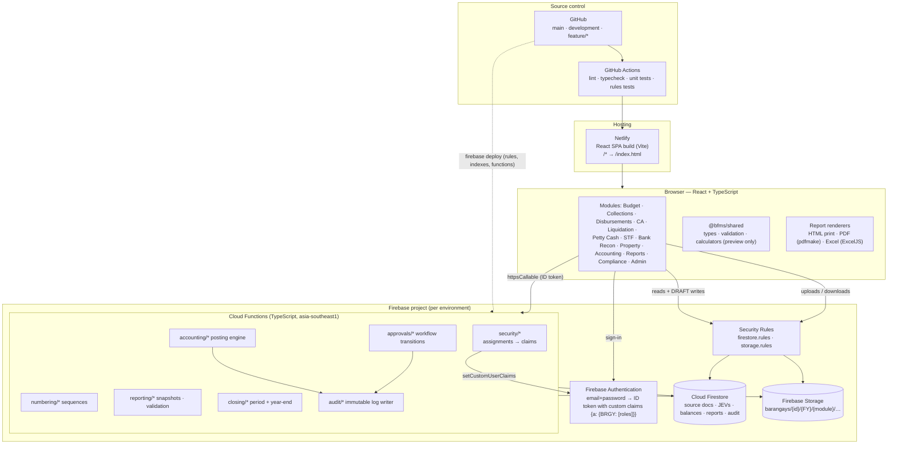
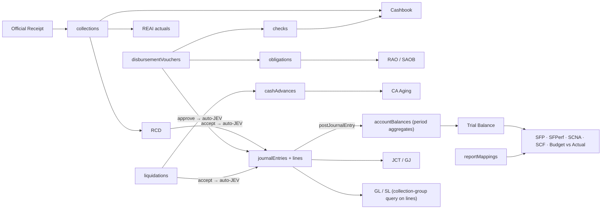

# 01 — System Architecture, Repository, Deployment, Environments

## 1. System Architecture Diagram



**Trust boundaries**

1. The browser is untrusted. It may read what the Security Rules allow and write only `DRAFT`/`RETURNED` source records in its own barangay.
2. The Cloud Functions are trusted. They re-verify identity (`context.auth`), active assignment, permission, barangay access, period status and document status. They recompute every total. They write through the Admin SDK inside Firestore transactions.
3. Security Rules are the second line of defense. They stay correct even if a function has a bug, because every accounting collection is `allow write: if false` for clients.

**Region.** Firestore and Functions run in `asia-southeast1` (Singapore), the closest GCP region to Negros Occidental. Set the region when the project is created; it cannot be changed later.

**Data flow ("enter once, generate everything")**



## 21. GitHub Repository Structure

This is an npm-workspaces monorepo. It has three packages that share one lockfile.

```
candoni-bfms/
├── src/                        # React app (Vite)
│   ├── components/             # Button, DataTable, StatusChip, Modal, ConfirmDialog, Toast, Money
│   ├── layouts/                # AppLayout (sidebar, topbar, barangay switcher), AuthLayout
│   ├── pages/                  # LoginPage, NotFound, Forbidden
│   ├── modules/
│   │   ├── dashboard/  budget/  collections/  accountableForms/  disbursements/
│   │   ├── payroll/  cashAdvances/  liquidations/  pettyCash/  trustFunds/
│   │   ├── bankReconciliation/  property/  accounting/  reports/  compliance/
│   │   ├── documents/
│   │   └── administration/     # users, barangays, fiscal years, periods, COA  (Phase 1–2)
│   ├── services/
│   │   ├── firebase/           # app init, emulator wiring
│   │   ├── auth/               # sign-in, claims decoding
│   │   ├── firestore/          # typed converters, cursor pagination
│   │   ├── storage/            # attachment upload/download
│   │   ├── functions/          # typed httpsCallable wrappers
│   │   └── reports/            # PDF / Excel renderers (Phase 12)
│   ├── contexts/               # AuthContext, BarangayContext, ToastContext
│   ├── hooks/                  # usePermission, usePaginatedQuery, useFiscalYear
│   ├── config/                 # navigation, env
│   └── main.tsx, App.tsx, routes.tsx
│
├── shared/                     # @bfms/shared — pure TS, no Firebase imports
│   └── src/
│       ├── types/              # every Firestore document interface
│       ├── constants/          # barangays, roles, statuses, collections, COA seed
│       ├── security/           # permission matrix, role helpers
│       ├── accounting/         # money, JEV validation, balances, CA, appropriation, recon
│       ├── workflow/           # allowed status transitions per module
│       └── numbering/          # document number formats
│
├── functions/                  # Cloud Functions (Node 22), bundled with esbuild
│   └── src/
│       ├── index.ts
│       ├── lib/                # admin init, callable wrapper, errors, context guard
│       ├── security/           # setUserAssignment, createUser, syncClaims
│       ├── admin/              # seedReferenceData, fiscal years
│       ├── numbering/          # nextNumber()
│       ├── accounting/         # postJournalEntry, reverseJournalEntry, submitJev, approveJev
│       ├── closing/            # lockAccountingPeriod, reopenAccountingPeriod, closeFiscalYear
│       ├── audit/              # writeAudit()
│       ├── approvals/ budget/ liquidation/ reconciliation/ reporting/   # later phases
│
├── tests/rules/                # @firebase/rules-unit-testing against the emulator
├── docs/architecture/          # this specification
├── scripts/                    # seed & migration CLIs
├── firestore.rules  firestore.indexes.json  storage.rules  firebase.json  .firebaserc
├── netlify.toml  .env.example  package.json  tsconfig*.json  vite.config.ts
└── .github/workflows/ci.yml
```

**Why a shared package?** The prompt requires that business rules not be duplicated. `@bfms/shared` holds pure functions such as `validateJournalBalance`, `computeCashAdvanceBalance` and `computeAppropriationBalance`. The Functions use them to **enforce** rules. The UI uses them only to **preview** (for example, to show "Debit ≠ Credit" before the user submits). esbuild bundles the package into the Functions build, so no private npm registry is needed.

### 92. Branching and pull requests

| Branch | Purpose | Deploys to |
|---|---|---|
| `main` | Production. Protected: PR required, CI must be green, 1 reviewer. | Netlify production + Firebase `prod` |
| `development` | Integration branch. | Netlify branch deploy + Firebase `staging` |
| `feature/*` | One per module, for example `feature/collections`, `feature/liquidations`, `feature/bank-reconciliation`. | Netlify deploy preview → Firebase `dev` |

CI (`.github/workflows/ci.yml`) runs `npm ci`, typecheck, unit tests (`shared`, `functions`) and the Security Rules tests in the Firestore emulator. Firebase deploys run from CI with a Workload Identity Federation or deploy-scoped service account stored in GitHub **environment secrets**. Keys are never committed.

## 22. Netlify Deployment Configuration

`netlify.toml`:

```toml
[build]
  command = "npm ci && npm run build -w @bfms/shared && npm run build:web"
  publish = "dist"

[build.environment]
  NODE_VERSION = "22"

[[redirects]]
  from = "/*"
  to = "/index.html"
  status = 200

[[headers]]
  for = "/*"
  [headers.values]
    X-Frame-Options = "DENY"
    X-Content-Type-Options = "nosniff"
    Referrer-Policy = "strict-origin-when-cross-origin"
    Permissions-Policy = "camera=(), microphone=(), geolocation=()"
    Content-Security-Policy = "default-src 'self'; connect-src 'self' https://*.googleapis.com https://*.firebaseio.com https://*.cloudfunctions.net https://*.run.app wss://*.firebaseio.com; img-src 'self' data: blob: https://firebasestorage.googleapis.com; style-src 'self' 'unsafe-inline'; script-src 'self'; frame-src https://*.firebaseapp.com"
```

**Environment variables.** Set these in the Netlify UI, per deploy context:

| Variable | Notes |
|---|---|
| `VITE_FIREBASE_API_KEY`, `VITE_FIREBASE_AUTH_DOMAIN`, `VITE_FIREBASE_PROJECT_ID`, `VITE_FIREBASE_STORAGE_BUCKET`, `VITE_FIREBASE_MESSAGING_SENDER_ID`, `VITE_FIREBASE_APP_ID` | Public web config. These values are not secrets: security comes from Rules and Functions. They still differ per environment. |
| `VITE_FUNCTIONS_REGION` | `asia-southeast1` |
| `VITE_APP_ENV` | `dev` / `staging` / `prod`. Drives the environment banner shown in non-prod. |
| `VITE_USE_EMULATORS` | `true` only for local development. |

**Custom domain.** Suggested domain: `bfms.mgocandoni.com`, following the existing `pms.` / `ims.` pattern. Add a CNAME in Squarespace DNS pointing to the Netlify site, then add the domain to Firebase Auth → Authorized domains.

## 23. Firebase Environment Strategy

| Environment | Firebase project ID (suggested) | Who uses it | Data |
|---|---|---|---|
| Local | emulators (`demo-bfms`) | Developers | Seeded fixtures only |
| Development | `candoni-bfms-dev` | Developers, feature previews | Synthetic data |
| Staging | `candoni-bfms-staging` | Municipal Accounting UAT, treasurer training | Anonymized copy of migrated data |
| Production | `candoni-bfms-prod` | All users | Official books |

`.firebaserc` defines aliases `dev`, `staging`, `prod`. Rules:

- Production data is **never** copied down unless it has been anonymized. Production IAM is limited to the Municipal Accountant and a break-glass admin.
- Enable **Point-in-Time Recovery** on the production Firestore database, plus scheduled daily exports (`gcloud firestore export`) to a locked, retention-policy Cloud Storage bucket. Retain exports for at least 10 years: government accounting records must be kept for the COA-prescribed retention period.
- Turn on App Check (reCAPTCHA Enterprise) in staging and production after Phase 1 is stable.
- Enable **email enumeration protection** and a password policy (minimum 12 characters, mixed classes) in Firebase Auth. Plan MFA (TOTP) for Municipal Accounting roles once the project is upgraded to Identity Platform.
