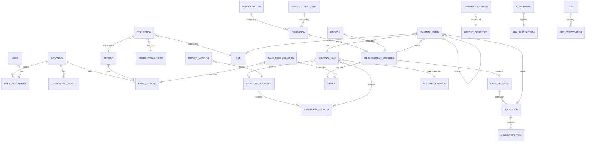

# 02 — Data Model

The authoritative field definitions are the TypeScript interfaces in `shared/src/types/`. This document explains their structure, keys and relationships. If this document and the code disagree, the code wins, and this document must be fixed in the same PR.

Conventions used by every collection:

- `Centavos` means an integer number of centavos. `IsoDate` means a `YYYY-MM-DD` string. `Ts` means a Firestore `Timestamp`.
- `BarangayScoped` = `{ barangayId, fiscalYear }`. `PeriodScoped` = `BarangayScoped & { accountingPeriod: 'YYYY-MM' }`.
- `Tracked` = `{ createdAt, createdBy, updatedAt, updatedBy }`. Server functions write these.
- `WorkflowTracked` = `Tracked & { status, submittedBy?, submittedAt?, reviewedBy?, reviewedAt?, approvedBy?, approvedAt?, postedBy?, postedAt?, returnInfo?, revisionNumber }`.
- Soft deletion only. Official records carry `status: 'VOID' | 'CANCELLED'` with a reason and are never deleted.

## 2. Firestore Collection Structure

Keys: 🔑 = deterministic ID. 🆔 = auto ID. **W** = client-writable (DRAFT/RETURNED only) versus **S** = server-only writes.

### Identity & tenancy

| Collection | ID | W/S | Purpose |
|---|---|---|---|
| `users/{uid}` | 🔑 Auth UID | S (a user may update `displayName` and `preferences` only) | Profile mirror of the Auth user |
| `roles/{roleId}` | 🔑 e.g. `barangay_treasurer` | S | Role catalog: label, description, permissions[] |
| `userAssignments/{assignmentId}` | 🆔 | S | `(uid, barangayId \| 'ALL', roles[], active, validFrom, validTo)`. The source of custom claims. |
| `barangays/{barangayId}` | 🔑 `AGBOY` … `WEST` | S | Barangay master and configurable signatories |
| `signatories/{id}` | 🆔 | S | Officials with a term (`validFrom`/`validTo`), so reports resolve the signatory *as of* the report date |
| `offices/{id}` | 🆔 | S | Offices and committees a transaction may be charged to (from the prototype) |

### Calendar & configuration

| Collection | ID | W/S |
|---|---|---|
| `fiscalYears/{fy}` | 🔑 `2026` (municipality-wide calendar) | S |
| `barangayFiscalYears/{bid_fy}` | 🔑 `AGBOY_2026` (per-barangay year status and opening balances flag) | S |
| `accountingPeriods/{bid_fy_mm}` | 🔑 `AGBOY_2026_09` | S |
| `chartOfAccounts/{accountCode}` | 🔑 `1-01-02-010` | S (Municipal Accountant) |
| `subsidiaryAccounts/{slId}` | 🔑 `AGBOY_1-03-03-020_EO05` | S (accounting) / proposals W |
| `funds/{fundId}` | 🔑 `GF`, `STF-TRUST106-AGBOY` | S |
| `fpp/{id}` | 🆔 Function/Program/Project per year (from the prototype) | S |
| `numberSequences/{bid_fy_docType}` | 🔑 | S |
| `uniqueKeys/{scope}` | 🔑 e.g. `CHK_AGBOY_LBP-0012-3456-78_1762250` | S |
| `reportDefinitions/{reportCode}` | 🔑 `RCD`, `CASHBOOK`, `TB` … | S |
| `reportMappings/{id}` | 🆔 | S |
| `complianceRequirements/{id}` | 🆔 | S |
| `systemSettings/{key}` | 🔑 `global`, `aging`, `numbering` | S |

### Budget

| Collection | ID | W/S |
|---|---|---|
| `appropriations/{id}` | 🆔 | W (Committee on Appropriations, DRAFT) → S |
| `appropriationAdjustments/{id}` | 🆔 supplemental, realignment and augmentation, each with an ordinance reference | W → S |
| `obligations/{id}` | 🆔 | W → S (certification is server-side) |
| `raoEntries/{id}` | 🆔 generated ledger lines per appropriation | S |
| `estimatedIncome/{id}` | 🆔 REAI estimates per income account | W → S |

### Treasury (source documents)

| Collection | ID | W/S |
|---|---|---|
| `collections/{id}` (+ `lines` array, ≤ 20 lines) | 🆔 | W |
| `deposits/{id}` | 🆔 | W |
| `rcdReports/{id}` | 🆔 groups collections and deposits into an RCD (`RCD No. YYYY-MM-NNN`) | W → S |
| `rcrReports/{id}` | 🆔 deputized collector remittances | W → S |
| `accountableForms/{id}` + `/issuances/{id}` | 🆔 | W → S |
| `disbursementVouchers/{id}` | 🆔 | W → S |
| `checks/{id}` | 🆔 | W (PREPARED) → S |
| `adas/{id}` | 🆔 Advice to Debit Account (prototype payment type) | W → S |
| `payrolls/{id}` + `/entries/{id}` | 🆔 | W → S |
| `cashAdvances/{id}` | 🆔 | S (created from an approved DV) |
| `liquidations/{id}` + `/items/{id}` | 🆔 | W → S |
| `pettyCashFunds/{id}`, `pettyCashTransactions/{id}` | 🆔 | W → S |
| `specialTrustFunds/{id}` | 🆔 | S |

### Bank

| Collection | ID | W/S |
|---|---|---|
| `bankAccounts/{id}` | 🆔 | S |
| `bankStatements/{id}` + `/lines/{id}` | 🆔 | W |
| `bankReconciliations/{bid_bank_fy_mm}` + `/items/{id}` | 🔑 | W (accounting) → S finalize |
| `bankMemos/{id}` | 🆔 debit/credit memos for the RBDCM | W (accounting) |

### Property

| Collection | ID | W/S |
|---|---|---|
| `ppe/{id}` | 🆔 property number unique via `uniqueKeys` | W (Property Officer) → S |
| `ppeDepreciation/{ppeId_fy_mm}` | 🔑 | S |
| `inventoryItems/{id}`, `inventoryTransactions/{id}` (RIS, IAR, stock card lines) | 🆔 | W → S |
| `propertyDocuments/{id}` (ICS, PAR, PTR, RRSP, IIRUP) | 🆔 | W → S |
| `biologicalAssets/{id}` | 🆔 | W → S |

### Accounting core (server-only writes)

| Collection | ID | Notes |
|---|---|---|
| `journalEntries/{jevId}` | 🆔 | Header. `jevNumber` is assigned at posting. |
| `journalEntries/{jevId}/lines/{lineId}` | 🆔 | Denormalized: `barangayId`, `fiscalYear`, `accountingPeriod`, `fundId`, `jevDate`, `jevNumber`, `posted`, `accountCode`, `subsidiaryId`, `debit`, `credit`. GL and SL read these with **collection-group queries**. |
| `accountBalances/{bid_fy_mm_fund_account_sl}` | 🔑 | Period movement aggregates `{ debit, credit }`, incremented atomically at posting. The TB and the statements read these, never raw lines. |
| `financialSummaries/{bid_fy}` | 🔑 | Dashboard counters (cash, CA outstanding, reports due …) |
| `closingRuns/{bid_fy}` | 🔑 | Year-end checklist state |

### Reporting, compliance, documents, audit

| Collection | ID | W/S |
|---|---|---|
| `generatedReports/{id}` | 🆔 versioned snapshots: `{bid, fy, reportCode, period, version}` unique | S |
| `reportSubmissions/{bid_fy_mm_reportCode}` | 🔑 the compliance matrix cell | S |
| `nfsNarratives/{bid_fy}` + `/versions/{v}` | 🔑 | W (accounting) → S finalize |
| `attachments/{id}` | 🆔 | W (metadata on upload) |
| `notifications/{id}` | 🆔 | S (the recipient may mark it read) |
| `workflowHistory/{id}` | 🆔 | S, append-only |
| `auditLogs/{id}` | 🆔 | S, append-only, no read for barangay users |
| `importBatches/{id}` + `/records/{id}` | 🆔 | S (upload via a function) |

## 3. Detailed Firestore Schema

The full schemas are in `shared/src/types/`. The key shapes, with fields beyond the master prompt marked ➕:

```ts
// shared/src/types/accounting.ts (excerpt)
interface JournalEntry extends PeriodScoped, WorkflowTracked {
  jevNumber: string | null;            // '2026-09-147' – assigned at POST
  jevDate: IsoDate;
  fundId: FundId;
  journal: 'JCT' | 'GJ';               // ➕ cash vs non-cash book
  entryType: 'REGULAR' | 'ADJUSTING' | 'CORRECTING' | 'REVERSING' | 'CLOSING' | 'OPENING'; // ➕
  sourceModule: SourceModule;          // 'COLLECTION' | 'DV' | 'LIQUIDATION' | 'MANUAL' …
  sourceDocumentId: string | null;
  primaryReference: string | null;     // ➕ check no. / OR no.  (legacy column)
  secondaryReference: string | null;   // ➕ DV no. / RCD no.
  tertiaryReference: string | null;    // ➕
  particulars: string;
  totalDebit: Centavos;                // server-computed
  totalCredit: Centavos;               // server-computed
  lineCount: number;                   // ➕ integrity check at post
  reversesJevId?: string;              // ➕
  reversedByJevId?: string;            // ➕
  status: 'DRAFT'|'FOR_REVIEW'|'RETURNED'|'APPROVED'|'POSTED'|'REVERSED';
}

interface JournalLine {
  barangayId; fiscalYear; accountingPeriod; fundId; jevDate; jevNumber; // denormalized
  posted: boolean;
  lineNo: number;
  accountCode: string;
  subsidiaryId: string | null;
  debit: Centavos; credit: Centavos;   // exactly one is > 0
  lineDescription: string;
  fppId?: string; officeId?: string;   // ➕ from the prototype
}
```

Key rules captured in the types and validators:

- **Appropriation**: `totalAppropriation = original + supplemental ± realignment ± adjustments`. `availableBalance = total − obligations`. The values are stored for query speed but **always rewritten by the server**. The `appropriationClass` enum is `REGULAR | SK_10PCT | LDRRMF_5PCT | DF_20PCT | CONTINUING | OTHER`, which drives the separate RAOs.
- **Collection lines**: `{ accountCode, subsidiaryId?, natureOfCollection, amount }[]`. The header `amount` equals the sum of the lines, recomputed by the server.
- **Cash advance**: `outstandingBalance = granted − liquidated − refunded`. `daysOutstanding` and `agingCategory` are recomputed nightly by a scheduled function, using the thresholds in `systemSettings/aging`.
- **Bank reconciliation**: `adjustedBook = book + creditMemos + interest − debitMemos − bankCharges ± bookErrors`. `adjustedBank = bank + depositsInTransit − outstandingChecks ± bankErrors`. `difference = adjustedBook − adjustedBank` must be 0 to finalize.

## 4. Relationship / Reference Map



**Reference rules**

1. References are stored as **ID strings plus a denormalized display snapshot** (for example `payee: { id, name, tin }`). A report shows the name as it was on the voucher date, even if the master record changes later.
2. Every cross-document reference must point to the **same `barangayId`**. The server checks this, so an Agboy DV cannot reference a Banga obligation.
3. Back-links (`dv.checkId`, `check.dvId`, `jev.sourceDocumentId`, `dv.jevId`) are written in the **same transaction** so the links never become one-sided.
4. A subsidiary account ID embeds its controlling account (`AGBOY_1-03-03-020_EO05`). Posting rejects a line whose `subsidiaryId` belongs to a different account or barangay.
