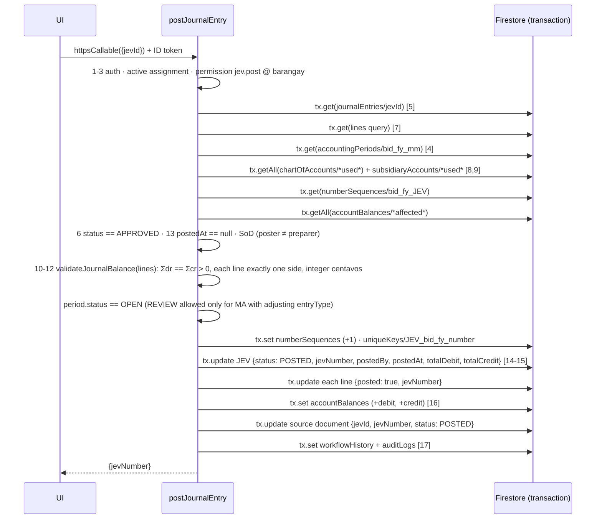
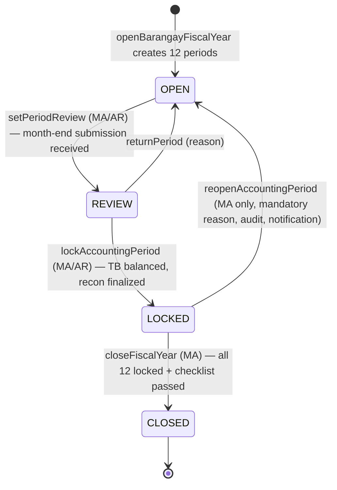

# 04 — Cloud Functions, Posting Engine, Audit, Numbering, Period Locking

## 8. Cloud Functions Architecture

All functions are **2nd-gen**, in region `asia-southeast1`, Node 22, and written in TypeScript. They are bundled with esbuild so that `@bfms/shared` is inlined.

### The standard callable pipeline

Every sensitive callable is wrapped by `secureCallable()` (`functions/src/lib/callable.ts`):

```
secureCallable({ permission, schema, barangayFrom }, handler)
  1. require request.auth                        → unauthenticated
  2. load users/{uid}; require active            → permission-denied
  3. load active userAssignments for uid         (fresh from Firestore, not only claims)
  4. validate input with zod schema              → invalid-argument
  5. resolve target barangayId (input or doc)    → must be in scope, else permission-denied
  6. require permission at that barangay         → permission-denied
  7. run handler(ctx) inside try/catch
  8. map domain errors (BfmsError) to HttpsError; unknown errors are logged and returned as `internal`
```

`ctx` carries `{ uid, userName, roles, barangayId, assignments, requestId }`, so handlers never re-derive identity.

### Function catalog

| Group | Function | Type | Phase |
|---|---|---|---|
| security | `createUserAccount`, `setUserAssignment`, `revokeUserAssignment`, `setUserActive`, `recordLogin`, `onUserAssignmentWritten` (claims sync trigger), `resyncDatedAssignments` (daily) | callable / trigger / scheduled | 1 |
| admin | `seedReferenceData` (barangays, roles, COA, report definitions, compliance requirements), `createFiscalYear`, `openBarangayFiscalYear` | callable | 1 |
| closing | `lockAccountingPeriod`, `reopenAccountingPeriod`, `setPeriodReview`, `closeFiscalYear`, `generateClosingEntries` | callable | 1 / 15 |
| numbering | `nextNumber()` (internal library, used inside other transactions) | lib | 1 |
| audit | `writeAudit()` (lib), `onAuthLogin` (blocking trigger `beforeSignIn`, which logs LOGIN) | lib / trigger | 1 |
| accounting | `saveJournalDraft`, `submitJournalEntry`, `returnJournalEntry`, `approveJournalEntry`, `postJournalEntry`, `reverseJournalEntry` | callable | 1 (engine) / 8 (UI) |
| approvals | `submitTransaction`, `returnTransaction`, `approveTransaction`, `acceptBarangaySubmission`, `voidTransaction` | callable | 3+ |
| budget | `certifyObligation` (runs `validateAppropriation`), `recomputeAppropriation` | callable | 3 |
| treasury | `issueOfficialReceipt`, `prepareRcd`, `issueCheck`, `releaseCheck`, `markChecksCleared` | callable | 4–5 |
| liquidation | `finalizeLiquidation`, `recordRefund`, `refreshCashAdvanceAging` (scheduled, daily 01:00 PHT) | callable / scheduled | 6 |
| reconciliation | `finalizeBankReconciliation`, `generateRbdcmEntries` | callable | 9 |
| property | `runMonthlyDepreciation` | callable | 10 |
| reporting | `generateReportSnapshot`, `finalizeReport`, `generateMonthlyPackage`, `refreshComplianceMatrix` (scheduled), `exportReport` (PDF/XLSX to Storage) | callable / scheduled | 12 |
| imports | `createImportBatch`, `validateImportBatch`, `approveImportBatch`, `commitImportBatch` | callable | 14 |
| ops | `scheduledFirestoreExport` (daily), `notifyDeadlines` (daily) | scheduled | 13/15 |

## 9. Accounting Posting Architecture

### Where JEVs come from

| Source (after acceptance) | JEV generator | Journal | Typical entry |
|---|---|---|---|
| RCD (collections and deposit) | `jevFromRcd` | JCT | Dr 1-01-01-010 (BT01) / Cr 4-xx income. Deposit: Dr 1-01-02-010 (CIB01) / Cr 1-01-01-010 |
| DV + check (regular expense) | `jevFromDv` | JCT | Dr expense / Cr 1-01-02-010; Cr 2-02-01-010 BIR01 for tax withheld |
| DV for a cash advance | `jevFromDv` | JCT | Dr 1-03-03-010 (AO##) or 1-03-03-020 (EO##) / Cr 1-01-02-010 |
| Liquidation | `jevFromLiquidation` | GJ | Dr expenses / Cr 1-03-03-0x0 (AO##); refund Dr 1-01-01-010 |
| Bank debit/credit memo | `jevFromBankMemo` | JCT | Dr 5-03-01-020 Bank Charges / Cr 1-01-02-010 |
| Depreciation run | `jevFromDepreciation` | GJ | Dr 5-04-01-0x0 / Cr 1-07-xx-xx1 |
| SK / LDRRMF transfer | `jevFromTransfer` | JCT | Dr 5-02-10-030 / Cr 1-01-02-010 |
| Manual (adjusting, correcting) | accountant | GJ | any |
| Closing | `generateClosingEntries` | GJ | revenue/expense → 3-01-02-010 → 3-01-01-010 |

The default account determination (`transactionTypes/{code}.jevTemplate`) is configuration, not code. The generator creates a **DRAFT** JEV, and the accountant can adjust the accounts before posting ("classify accounts").

### `postJournalEntry({ jevId })`: the process in one transaction



**Guarantees**

- **Atomic.** Any failure aborts the whole transaction, so no partial books are written. Firestore allows up to 500 writes per transaction; a JEV is limited to 150 lines. In the worst case that is 150 line updates, plus 300 balance rows, plus about 7 header, source, audit and sequence writes, which stays under the limit.
- **Idempotent.** A retry after success sees `status == POSTED` and returns the existing `jevNumber` instead of posting twice.
- **Concurrency.** Two posts that race on the same sequence or balance document are serialized by Firestore's optimistic transactions and retried automatically. Gapless numbering is preserved because the number is allocated only on a successful commit.
- **Frozen.** After posting, rules forbid all client writes, and every accounting function refuses to mutate a `POSTED` JEV except `reverseJournalEntry`. That function creates a **new** JEV with debits and credits swapped, `entryType: 'REVERSING'`, `reversesJevId`, and sets `reversedByJevId` on the original. The original's lines are never touched.

### Balances model

`accountBalances/{bid}_{fy}_{mm}_{fund}_{account}_{sl|'-'}` = `{ debit, credit, lineCount }`. These are period movements, not cumulative balances. The opening balance lives in period `00` (the `OPENING` entry type). This gives:

- Trial Balance as of month *m*: sum periods `00..m` per account, which is at most about 13 × 274 small documents per barangay per year.
- Monthly TB, Pre-Closing TB (`00..12` excluding `CLOSING` entries, which post to period `13`) and Post-Closing TB (`00..13`).
- SL-to-GL reconciliation: Σ over the SL documents of an account = the account's `'-'` roll-up, both written in the same transaction.

## 17. Audit Trail Architecture

- `auditLogs` is **append-only**. It is written only by `writeAudit()` inside the same transaction as the change it describes, so an action cannot succeed without its audit record. Rules: client create/update/delete ✗; read only for `audit.read`.
- Document shape: `{ timestamp, uid, userName, roles, barangayId, module, recordId, action, oldValue, newValue, reason, source: 'callable:postJournalEntry' | 'trigger' | 'import', requestId, ip? }`.
- `oldValue`/`newValue` store a **diff** of the changed fields only, capped at 20 KB. Larger diffs store a hash plus the path to a Storage copy.
- Actions logged: `CREATE, EDIT, SUBMIT, RETURN, RESUBMIT, APPROVE, ACCEPT, POST, REVERSE, VOID, UPLOAD, DELETE_ATTACHMENT, LOCK_PERIOD, REOPEN_PERIOD, CHANGE_ROLE, FINALIZE_REPORT, CLOSE_YEAR, LOGIN, EXPORT, IMPORT_COMMIT`.
- Client-side DRAFT edits are captured by an `onDocumentWritten` trigger on the source collections, which records `EDIT` with a diff. This way edits made directly under the rules are audited too.
- **Tamper evidence.** Each audit document stores `prevHash` (the SHA-256 of the previous log in the same barangay chain, kept in `auditChains/{bid}`) and `hash`. A nightly verifier recomputes the chain and raises a notification if any break is found.
- Retention: Firestore auditLogs are kept indefinitely. The daily export gives an offline copy.

## 18. Numbering Strategy

| Document | Format | Scope of counter | Assigned when | Example (legacy-compatible) |
|---|---|---|---|---|
| JEV | `YYYY-MM-NNN` | barangay + fiscal year (running across months) | at POST | `2025-01-003` |
| DV | `YYYY-MM-NNN` | barangay + fiscal year | at PB approval | `2025-03-038` |
| RCD | `YYYY-MM-NNN` | barangay + fiscal year | at submit | `2025-02-004` |
| Obligation Request | `OBR-YYYY-MM-NNN` | barangay + fiscal year + fund | at certification | `OBR-2026-09-012` |
| Liquidation Report | `LR-YYYY-MM-NNN` | barangay + fiscal year | at submit | |
| Payroll | `PR-YYYY-MM-NNN` | barangay + fiscal year | at approval | |
| PCV | `PCV-YYYY-NNNN` | petty cash fund | at payment | |
| Property No. (PPE) | `YYYY-{PPEcode}-NNNN` | barangay | at acceptance | `2026-05-020-0003` |
| ICS / PAR | `ICS-YYYY-MM-NNN`, `PAR-YYYY-MM-NNN` | barangay + fiscal year | at issue | |
| Bank recon | `BRS-YYYY-MM` + bank | one per bank per month (deterministic ID) | at creation | |
| OR / check numbers | **pre-printed**, not generated | validated against the accountable form range or check booklet | on use | `1762250` |

- `numberSequences/{bid}_{fy}_{docType}` = `{ currentNumber, prefix, format, padding }`.
- `nextNumber(tx, key)` must be called **inside** the caller's transaction. It reads, increments, writes, and creates `uniqueKeys/{docType}_{bid}_{fy}_{formatted}` as a second guard.
- Numbers come only from the server. Drafts display "(assigned on posting)".
- Voided documents keep their number, with status `VOID`. Numbers are never reused, so an auditor can account for every number in the series.

## 19. Period Locking Strategy



| Period status | Barangay drafts | Submit | Post regular | Post adjusting (MA) | Generate FINAL report |
|---|---|---|---|---|---|
| OPEN | ✓ | ✓ | ✓ | ✓ | ✗ |
| REVIEW | ✓ (RETURNED items only) | ✓ | ✓ | ✓ | ✗ |
| LOCKED | ✗ | ✗ | ✗ | ✗ | ✓ |
| CLOSED | ✗ | ✗ | ✗ | ✗ | ✓ |

- The period is resolved from the document's **accounting date** (`jevDate`, `dvDate` …), never from "today".
- Locking runs the **lock checklist**: no un-posted APPROVED JEVs in the period, TB balanced for months `00..m`, and bank reconciliations for the month in FINAL (or waived with a reason).
- Reopening stores `{ reopenedAt, reopenedBy, reopenReason }` and appends to `accountingPeriods/{id}.history[]`. Any FINAL report for that period is flagged `STALE_SOURCE`. When the period is locked again, a new report version must be generated; the old FINAL version is kept.
- Transactions whose accounting date falls in a LOCKED period must be dated in the current open period. A prior-period correction uses an adjusting entry in the open period, charged to `3-01-01-020 Prior Years' Adjustments` where applicable.
