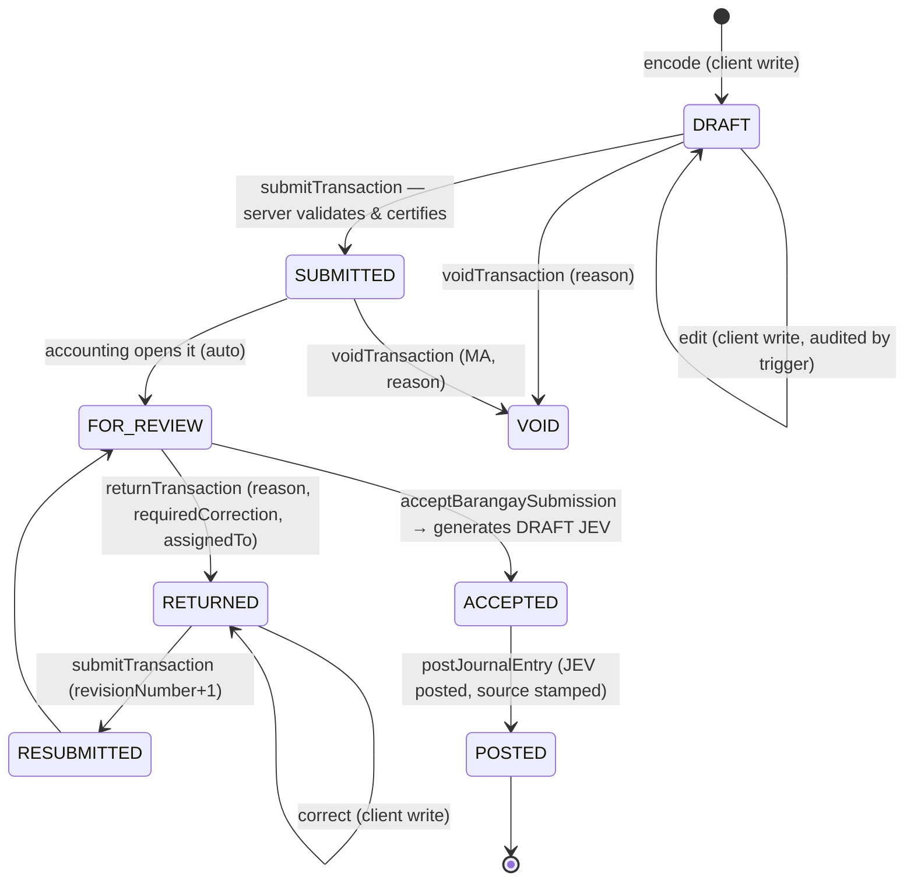
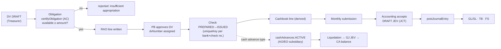
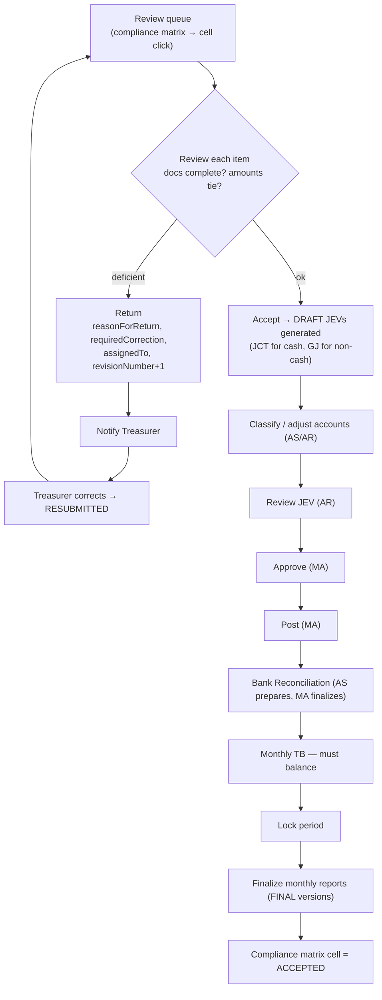

# 05 — Workflows

The allowed transitions per module live in `shared/src/workflow/transitions.ts`. The server rejects any transition not listed there. Every transition writes one `workflowHistory` record and one `auditLogs` record in the same transaction.

## 10. Transaction Workflow

### Generic source-document lifecycle



### DV-specific path (disbursement chain from Section CIII)



Validations at each gate:

| Gate | Server check |
|---|---|
| Certify obligation | Appropriation exists, same barangay/FY/fund, status ACTIVE. `available ≥ amount`. For STF charges: `stf.balance ≥ amount`. |
| PB approval | Obligation certified. `gross − tax − other = net`. Supporting documents for the DV type exist in `attachments` (the checklist comes from `transactionTypes`). Approver ≠ preparer. |
| Issue check | Check number is within the booklet range and not already used for that bank account. Amount = DV net. |
| Submit | Period OPEN/REVIEW. All required fields present. Totals recomputed. |
| Accept | Reviewer has `submission.accept`. The JEV template resolves to active accounts. |
| Post | See [04 §9](04-accounting-engine.md#9-accounting-posting-architecture). |

## 11. Barangay Submission Workflow

This is the monthly cycle for each barangay.

```mermaid
sequenceDiagram
  actor BT as Barangay Treasurer
  actor AC as Committee on Appropriations
  actor PB as Punong Barangay
  participant SYS as BFMS
  actor MA as Municipal Accounting
  BT->>SYS: Encode ORs, deposits, DVs, checks, payroll, CA, liquidations (throughout month)
  AC->>SYS: Certify obligations; RAO updates automatically
  PB->>SYS: Approve DVs / payrolls / CAs
  BT->>SYS: Upload bank statement, deposit slips, supporting docs
  BT->>SYS: "Generate Monthly Submission Package" (month M)
  SYS-->>BT: Checklist: REQUIRED / GENERATED / MISSING / NOT APPLICABLE + validation (PASSED/WARNING/FAILED)
  BT->>SYS: Fix FAILED items (e.g., RCD collections ≠ deposits unexplained)
  BT->>SYS: Certify & Submit package (Cashbook, RCD, RAAF, Checks Issued, CA/LR, Payroll, REAI; AC submits RAO/SAOB)
  SYS->>MA: Notification "AGBOY 2026-09 package submitted"
  SYS->>SYS: accountingPeriods/AGBOY_2026_09 → REVIEW; reportSubmissions cells → SUBMITTED
```

The package is a `generatedReports` bundle: each report is a versioned snapshot with `sourceDataCutoff`. The package manifest records every report's version, so later edits cannot silently change what was submitted.

## 12. Municipal Accounting Review Workflow



Return records are never overwritten. Each return appends to `returnHistory[]` on the document, and `workflowHistory` holds the full trail, so the original and every revision stay visible.
