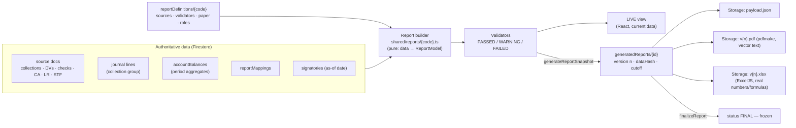

# 06 — Reporting: Architecture, Responsibility, COA Form Matrix, FS Mapping

## 13. Report Generation Architecture



**One model, three renderers.** Each report has a pure builder, `buildRcd(data) → ReportModel`. The `ReportModel` is a typed tree: header, column groups, rows with numeric cells in centavos, subtotals, validations and signatories. Three renderers consume the same model:

1. **HTML** for on-screen viewing and browser printing, with a print stylesheet per paper size and orientation.
2. **PDF** through pdfmake, as real text rather than a screenshot. It uses legacy-style headers ("Republic of the Philippines / Province of Negros Occidental / Municipality of Candoni / BARANGAY …") and signature blocks.
3. **Excel** through ExcelJS, with numeric cells, peso number formats and merged header rows that match the existing workbooks.

**Live vs Final**

- A *Live* report is built on demand from current data, in the browser for small reports and in a function for heavy ones (GL, SL, TB, FS).
- A *Final* report is built only by `generateReportSnapshot()` on the server. The server stores the canonical payload JSON, `sourceDataCutoff` and `dataHash`. `finalizeReport()` requires every validator to be non-FAILED **and** the period to be LOCKED. A FINAL version is never overwritten: a revision creates version *n+1* with `supersedesReportId`, and the prior version becomes ARCHIVED.
- If a period is reopened, its FINAL reports get `staleSource = true`. The UI shows "Superseded source data — regenerate after relock".

**Validators (Section LVIII)** are pure functions in `shared/src/accounting/*`. Each one is referenced by ID from `reportDefinitions.validations`:

| ID | Rule | Implemented by |
|---|---|---|
| `RCD_COLLECTIONS_EQ_DEPOSITS` | Collections = Deposits, or an explained undeposited amount (WARNING) | `validateRcd` |
| `CASHBOOK_ROLLFORWARD` | Beginning + Receipts − Payments = Ending | `buildCashbook().valid` |
| `OBLIGATION_WITHIN_APPROPRIATION` | Obligation ≤ available appropriation | `assertAppropriationAvailable` |
| `LIQUIDATION_RECONCILES` | CA − Liquidated − Refund = Outstanding | `computeLiquidation` |
| `BRS_BALANCED` | Adjusted book = adjusted bank | `computeBankReconciliation` |
| `TB_BALANCED` | Σ Dr = Σ Cr | `buildTrialBalance().balanced` |
| `SFP_BALANCED` | Assets = Liabilities + Net Assets | `checkFinancialPosition` |
| `SCF_RECONCILES` | Ending cash = Σ cash accounts | `checkCashFlow` |
| `SL_EQUALS_GL` | Σ SL = controlling GL | `reconcileSubsidiaries` |
| `AF_NO_GAPS` | No missing, duplicate or unexplained serials in accountable forms | Phase 4 |
| `JEV_BALANCED` | Every JEV in scope balances | `validateJournalBalance` |

**Monthly Submission Package (Section LIX).** `generateMonthlyPackage({barangayId, fy, month})` takes every definition with `inMonthlyPackage = true` and applies the `complianceRequirements` in effect for that period. For each one it:

- sets NOT_APPLICABLE when it finds no source records. Example: no petty cash fund means no PCR or SPCD.
- otherwise generates a snapshot and runs its validators.
- updates `reportSubmissions/{bid}_{fy}_{mm}_{code}`, which is the compliance matrix cell.

It then writes a Transmittal Letter listing every item and version. Submission is blocked while any item is FAILED.

## 14. Report Responsibility Matrix

This is the rule from Section LIII: the Barangay Treasurer does **not** own every report.

| Responsible office | Prepares | Certifies | Approves | Reports |
|---|---|---|---|---|
| **Barangay Treasurer** | BT | BT | PB where the form calls for it | Cashbook, Cashbook-DO, RCD, RCR, REAI (actuals), RAAF, Checks Issued, Cancelled Checks, DV (prepared), Payroll, Liquidation Report, PCV, PCR, SPCD, RSTF, Transmittal |
| **Committee on Appropriations** | AC | AC | PB (SAOB) | RAO (all classes: Regular, SK, 5% LDRRMF, 20% DF, Continuing), SAOB, appropriation certification on the DV/OBR |
| **Property / Inventory Officer** | PO | — | PB | RIS, ICS, PAR, Stock Card, PR, PO, AIR, RRPE, IIRUP, RPCPPE, RPCI, RSMI, ARDSM, BAPC, QRBA |
| **Municipal Accounting** | MA / AS | MA | — | JCT, GJ, GL, SL, JEV, TB, BRS and schedules, RBDCM, CA Aging, PPE Depreciation, PELC, Schedule of Accounts, SFPerf, DSFPerf, SFP, DSFP, SNAE, SCNAE, SCF, SCBAA, NFS, SMR (PB signs as head of agency) |

Signatories are resolved from `signatories` by role, **as of the report date**, never hard-coded. For example, the legacy Bank Reconciliation shows "Prepared by: NEIL P. PRIOLO, CPA, Municipal Accountant · Verified and found correct: COA Auditor". In BFMS those names come from `signatories/{MUNICIPAL, MUNICIPAL_ACCOUNTANT}` and `signatories/{MUNICIPAL, COA_AUDITOR}`.

## 15. COA Form / Report Matrix

This table is generated from `shared/src/constants/reportDefinitions.ts` by `scripts/gen-report-matrix.ts`. Do not edit it by hand.

Legend: Gen AUTO = fully derived from data · FORM = printable form of one record · HYBRID = derived numbers plus editable narrative. Pkg = included in the monthly submission package. Paper: P = portrait, L = landscape. Roles use the claim codes in [03 §5](03-security.md#5-role-and-permission-matrix).

> **Deadlines** start from the rules in `defaultDeadline()`:
> - Barangay monthly reports: 10 days after month-end.
> - Municipal Accounting monthly books: the 20th of the following month.
> - Annual financial statements: February 14.
>
> Each rule is seeded with `deadlineConfirmed: false`. **The Municipal Accountant must confirm every deadline against the current MFMB and COA circulars before go-live.** They are configuration, so no code change is needed.

| # | Code | Report / form | Responsible office | Prep | Cert | Appr | Frequency | Gen | Pkg | Paper | Phase |
|---|---|---|---|---|---|---|---|---|---|---|---|
| 1 | `JCT` | Journal of Cash Transactions | municipal accounting | MA | MA | — | monthly | AUTO |  | LEGAL L | 8 |
| 2 | `GJ` | General Journal | municipal accounting | MA | MA | — | monthly | AUTO |  | LEGAL L | 8 |
| 3 | `GL` | General Ledger | municipal accounting | MA | MA | — | monthly | AUTO |  | A4 L | 8 |
| 4 | `SL` | Subsidiary Ledger | municipal accounting | MA | MA | — | monthly | AUTO |  | A4 L | 8 |
| 5 | `JEV` | Journal Entry Voucher | municipal accounting | AS | MA | MA | per transaction | FORM |  | A4 P | 8 |
| 6 | `RAO` | Record of Appropriations and Obligations | committee on appropriations | AC | AC | — | monthly | AUTO | ✓ | LEGAL L | 3 |
| 7 | `SAOB` | Statement of Appropriations, Obligations and Balances | committee on appropriations | AC | AC | PB | monthly | AUTO | ✓ | LEGAL L | 3 |
| 8 | `REAI` | Record of Estimated and Actual Income | barangay treasurer | BT | BT | — | monthly | AUTO | ✓ | LEGAL L | 3 |
| 9 | `CASHBOOK` | Cashbook | barangay treasurer | BT | BT | — | monthly | AUTO | ✓ | LEGAL L | 4 |
| 10 | `CASHBOOK_DO` | Cashbook - Disbursing Officer | barangay treasurer | BT | BT | — | monthly | AUTO | ✓ | LEGAL L | 6 |
| 11 | `RCD` | Report of Collections and Deposits | barangay treasurer | BT | BT | — | per transaction | AUTO | ✓ | A4 P | 4 |
| 12 | `RCR` | Report of Collections and Remittances | barangay treasurer | BT | BT | — | per transaction | AUTO | ✓ | A4 P | 4 |
| 13 | `RBDCM` | Report of Bank Debit and Credit Memos | municipal accounting | MA | MA | — | monthly | AUTO |  | A4 P | 9 |
| 14 | `BRS` | Bank Reconciliation Statement | municipal accounting | MA | MA | — | monthly | AUTO |  | A4 P | 9 |
| 15 | `DV` | Disbursement Voucher | barangay treasurer | BT | AC | PB | per transaction | FORM |  | A4 P | 5 |
| 16 | `PCV` | Petty Cash Voucher | barangay treasurer | BT | — | PB | per transaction | FORM |  | A4 P | 6 |
| 17 | `PCR` | Petty Cash Record | barangay treasurer | BT | BT | — | monthly | AUTO | ✓ | A4 L | 6 |
| 18 | `PAYROLL` | Payroll | barangay treasurer | BT | BT | PB | per transaction | FORM | ✓ | LEGAL L | 5 |
| 19 | `LR` | Liquidation Report | barangay treasurer | BT | BT | PB | per transaction | FORM | ✓ | A4 P | 6 |
| 20 | `TRANSMITTAL` | Transmittal Letter | barangay treasurer | BT | — | PB | monthly | AUTO | ✓ | A4 P | 12 |
| 21 | `SPCD` | Summary of Petty Cash Disbursements | barangay treasurer | BT | BT | — | monthly | AUTO | ✓ | A4 P | 6 |
| 22 | `RAAF` | Report of Accountability for Accountable Forms | barangay treasurer | BT | BT | — | monthly | AUTO | ✓ | LEGAL L | 4 |
| 23 | `ARDSM` | Acknowledgement Receipt for Donated Supplies and Materials | property office | PO | — | PB | per transaction | FORM |  | A4 P | 10 |
| 24 | `RIS` | Requisition and Issue Slip | property office | PO | — | PB | per transaction | FORM |  | A4 P | 10 |
| 25 | `ICS` | Inventory Custodian Slip | property office | PO | — | PB | per transaction | FORM |  | A4 P | 10 |
| 26 | `STOCK_CARD` | Stock Card | property office | PO | — | — | on demand | AUTO |  | A4 P | 10 |
| 27 | `PR` | Purchase Request | bac or procurement | PO | AC | PB | per transaction | FORM |  | A4 P | 10 |
| 28 | `PO` | Purchase Order | bac or procurement | PO | AC | PB | per transaction | FORM |  | A4 P | 10 |
| 29 | `PAR` | Property Acknowledgement Receipt | property office | PO | — | PB | per transaction | FORM |  | A4 P | 10 |
| 30 | `PEC` | Property / Equipment Card | property office | PO | — | — | on demand | AUTO |  | A4 P | 10 |
| 31 | `PELC` | Property / Equipment Ledger Card | municipal accounting | AS | MA | — | on demand | AUTO |  | A4 L | 10 |
| 32 | `AIR` | Acceptance and Inspection Report | inspection committee | PO | — | PB | per transaction | FORM |  | A4 P | 10 |
| 33 | `RRPE` | Return and Receipt of Property / Equipment | property office | PO | — | PB | per transaction | FORM |  | A4 P | 10 |
| 34 | `IIRUP` | Inventory, Inspection and Appraisal Report | property office | PO | — | PB | on demand | AUTO |  | A4 L | 10 |
| 35 | `RPCPPE` | Report on Inventory of Property and Equipment | property office | PO | — | PB | annual | AUTO |  | LEGAL L | 10 |
| 36 | `RPCI` | Report on Inventory of Supplies and Materials | property office | PO | — | PB | semestral | AUTO |  | LEGAL L | 10 |
| 37 | `RSMI` | Summary of Supplies and Materials Issued | property office | PO | — | — | monthly | AUTO | ✓ | A4 P | 10 |
| 38 | `BAPC` | Biological Assets Property Card | property office | PO | — | — | on demand | AUTO |  | A4 P | 10 |
| 39 | `QRBA` | Quarterly Report of Biological Assets | property office | PO | — | PB | quarterly | AUTO |  | A4 P | 10 |
| 40 | `RSTF` | Registry of Special Trust Fund | barangay treasurer | BT | BT | — | monthly | AUTO | ✓ | LEGAL L | 7 |
| 41 | `SMR` | Statement of Management Responsibility | municipal accounting | MA | PB | — | annual | AUTO |  | A4 P | 11 |
| 42 | `SFPERF` | Statement of Financial Performance | municipal accounting | MA | MA | — | annual | AUTO |  | A4 P | 11 |
| 43 | `DSFPERF` | Detailed Statement of Financial Performance | municipal accounting | MA | MA | — | annual | AUTO |  | A4 P | 11 |
| 44 | `SFP` | Statement of Financial Position | municipal accounting | MA | MA | — | annual | AUTO |  | A4 P | 11 |
| 45 | `DSFP` | Detailed Statement of Financial Position | municipal accounting | MA | MA | — | annual | AUTO |  | A4 P | 11 |
| 46 | `SNAE` | Statement of Net Assets / Equity | municipal accounting | MA | MA | — | annual | AUTO |  | A4 P | 11 |
| 47 | `SCNAE` | Statement of Changes in Net Assets / Equity | municipal accounting | MA | MA | — | annual | AUTO |  | A4 P | 11 |
| 48 | `SCF` | Statement of Cash Flows | municipal accounting | MA | MA | — | annual | AUTO |  | A4 P | 11 |
| 49 | `SCBAA` | Statement of Comparison of Budget and Actual Amounts | municipal accounting | MA | MA | — | annual | AUTO |  | A4 L | 11 |
| 50 | `NFS` | Notes to Financial Statements | municipal accounting | MA | MA | — | annual | HYBRID |  | A4 P | 11 |
| — | `TB` | Trial Balance (Monthly / Pre-Closing / Post-Closing) | municipal accounting | MA | MA | — | monthly | AUTO |  | A4 P | 8 |
| — | `CHECKS_ISSUED` | Report of Checks Issued | barangay treasurer | BT | BT | — | monthly | AUTO | ✓ | A4 L | 5 |
| — | `CHECKS_CLEARED` | Checks Cleared / Encashed | municipal accounting | AS | MA | — | monthly | AUTO |  | A4 P | 9 |
| — | `OUTSTANDING_CHECKS` | Schedule of Outstanding Checks | municipal accounting | AS | MA | — | monthly | AUTO |  | A4 P | 9 |
| — | `CANCELLED_CHECKS` | Cancelled Checks | barangay treasurer | BT | BT | — | monthly | AUTO | ✓ | A4 P | 5 |
| — | `CA_AGING` | Aging of Unliquidated Cash Advances | municipal accounting | AS | MA | — | monthly | AUTO |  | A4 L | 6 |
| — | `PPE_DEPRECIATION` | PPE Depreciation Schedule | municipal accounting | AS | MA | — | annual | AUTO |  | A4 L | 10 |
| — | `SCHEDULE_OF_ACCOUNTS` | Schedule of Accounts (Subsidiary Balances) | municipal accounting | AS | MA | — | monthly | AUTO |  | A4 P | 8 |
| — | `BRS_SCHEDULES` | Bank Reconciliation Schedules | municipal accounting | AS | MA | — | monthly | AUTO |  | A4 P | 9 |
| — | `COMPLIANCE` | Compliance Report | municipal accounting | MA | — | — | monthly | AUTO |  | A4 L | 12 |

## 16. Financial Statement Mapping Architecture

Statement figures are **never hard-coded in React components**. The flow is:

```
accountBalances (posted, by period)  ──►  TB rows per account (net, signed by normal balance)
                                              │
reportMappings  (accountCode|prefix* → statement · section · lineItem · sortOrder · signMultiplier)
                                              │
                                              ▼
                               Statement model (lines, subtotals, comparatives)
```

1. **Seed.** Each account gets a default `financialStatementClassification` from its group prefix, using the longest match (`shared/src/constants/chartOfAccounts.ts`). For example `1-01 → SFP.CA.CASH`, `4-01-04-010 → SFPERF.REV.SHARE_IRA` and `5-02-10 → SFPERF.TRANSFERS_TO`. The seed turns these into `reportMappings` documents. The unit test `every account is mapped` guarantees that no account is `UNMAPPED`.
2. **Line catalog.** It follows the legacy Agboy 2025 statements exactly, so migrated comparatives line up:
   - **SFPerf:** Tax Revenue · Share from Internal Revenue Collections · Share from National Wealth · Service and Business Revenue · Grants and Donations · Gains → *Total Revenue*; Personnel Services · MOOE · Non-cash Expenses · Financial Expenses → *Current Operating Expenses*; *Surplus (Deficit) from Current Operations*; ± Transfers, Assistance and Subsidy From/To → *Surplus (Deficit) for the Period*.
   - **SFP:** Current Assets (Cash and Cash Equivalents, Investments, Receivables, Inventories, Prepayments and Deferred Charges) · Non-Current Assets (Investments, Receivables, Investment Property, PPE, Biological Assets) · Current and Non-Current Liabilities · Net Assets/Equity.
   - **SCNAE:** Balance at January 1 · Changes in Accounting Policy · Prior Years' Adjustments → Restated · Surplus/Deficit for the period → Balance at December 31.
   - **SCF (direct method, as in the legacy workbook):** Collection from Taxpayers · Share from IRA · Receipts from sale of goods/services · Interest · Other Receipts → Total Cash Inflow; the outflow lines; investing (PPE purchases); financing.
3. **Detailed statements** (DSFP, DSFPerf) list each account under its line, with the account code, as in the legacy detailed sheets.
4. **Contra accounts** such as Accumulated Depreciation and Allowances carry `signMultiplier −1` within their asset line, so PPE is shown **net**.
5. **Cash-flow classification** comes from the *counter-account* of each posted cash line in the JCT. For example, Cr 4-01-04-010 against Dr cash → Operating inflow "Share from IRA", and Dr 1-07-xx against Cr cash → Investing outflow. The per-account `cashFlowClassification` and the `reportMappings.cashFlowClassification` override set this. Non-cash lines (5-04 depreciation) are excluded. The validator requires ending cash to equal the TB cash accounts.
6. **Comparatives.** A statement for year *Y* is built from balances for *Y*, *Y−1* and *Y−2* (Section LXIX). Migrated prior years load as `OPENING`/`IMPORT` entries into their own fiscal years. The legacy three-year comparative TB is therefore reproduced from the database, not typed in.
7. **Versioning.** Mappings carry `effectiveFromYear`. A remapping applies prospectively. When a prior-year comparative is restated, the notes disclose it.
8. **Notes to FS.** Numeric schedules in the NFS (PPE roll-forward, receivables aging, cash breakdown) are generated from the same model. Narrative blocks live in `nfsNarratives/{bid_fy}/versions/{v}`, can be edited by MA/AR, and are frozen on finalize.
