# 07 — Legacy Data Migration Strategy (Section LXXXIX–XC)

## 20.1 What the legacy workbooks contain

I surveyed `01_AGBOY_2025 [COA]` on 2026-09-24. The same template is used by `03_CABIA-AN`, `04_CANINGAY`, `06_GATUSLAO` and `08_PAYAUAN` for 2022–2025. It holds these sheets:

| Legacy sheet (as found) | Content | BFMS target |
|---|---|---|
| **PY DB** (opening balances) | Flat journal lines, `Date = 1/1/YYYY`, `Particulars = Opening Balance` | `journalEntries` of type `OPENING` in period `YYYY-00` (one JEV per barangay/year) |
| **01_CY DB** (current-year lines) | One row per Dr/Cr line: Primary Reference (check no.), Account Code, SL, Account Name, Debit, Credit, JEV No, Name, Secondary Reference (DV no.), Tertiary Reference, Date, Particulars, Transaction Type, Month | `journalEntries` plus `lines`, grouped by JEV No. Source is `IMPORT`, with an optional back-fill of `checks` and `disbursementVouchers` headers |
| **COA list / MASTER DB** | Account Code, Name, Normal Balance, active codes, SL master (`BT01`, `CIB01`, `LGU01`, `AO01–03`, `EO01–24`, `OR01–02`, `AP01`, `BIR01`, `NGA01`, `LGU01–02`) | `chartOfAccounts` (already seeded, 274 accounts) and `subsidiaryAccounts` (`{bid}_{account}_{code}`) |
| TB (opening/movement/ending) | Derived | **Not imported.** Used as a reconciliation target |
| Comparative TB 2025/2024/2023 | Derived | **Not imported.** Prior years are imported as their own `OPENING` + `IMPORT` entries; the comparative is regenerated and must match |
| Schedule of Accounts | SL balances | Reconciliation target for `SL_EQUALS_GL` |
| List of Unliquidated Cash Advances | CHECK NO, DATE, DV NO, ACCOUNT, AO, PARTICULARS, OLD/NEW CODE, AMOUNT | `cashAdvances` with `isLegacy: true`. The outstanding amount is taken from the list, and the sum must tie to 1-03-03-010/-020 by SL |
| PPE depreciation schedule | Account, cost, residual, depreciable amount, life, annual depreciation, accumulated | `ppe` (one asset per line, or a pooled asset per account where item detail is missing), with `accumulatedDepreciation` as of the cut-over date |
| GL / SL sheets | Derived views | Reconciliation targets only |
| Checks issued (DATE, CHECK NO., AMOUNT) and bank recon schedules (Checks Issued Reconciliation, Deposits Reconciliation) | Outstanding checks from prior years and the current year | `checks` with status `OUTSTANDING`/`CLEARED`; the first `bankReconciliations` starting point |
| SFP, DSFP, SFPerf, DSFPerf, SCF, SCNAE | Statements | Reconciliation targets. The regenerated statements must equal them to the centavo |

The prototype workbook **Barangay Accounting System — Master** (Apps Script) contributes the ideas of *FPP* (Function/Program/Project per year), *Offices*, *DV Category* and *ADA*. All of these were adopted. Its "Login Credentials" and "Active Sessions" sheets are **not** migrated. Authentication moves entirely to Firebase Auth. Recommendation: delete those sheets and rotate any passwords they held.

## 20.2 Data-quality issues found → validation rules

| # | Finding in legacy data | Validation rule (import) | Severity |
|---|---|---|---|
| 1 | `2-01-02-010` used for both *Leave Benefits Payable* and *Other Provisions* | `DUP_ACCOUNT_CODE`: an account code maps to more than one name. The seed re-codes Other Provisions to `2-01-02-990`, **pending MA confirmation** | ERROR until mapped |
| 2 | `1-03-01-011` Allowance for Impairment – AR tagged **Debit** normal | `CONTRA_NORMAL_BALANCE`: accounts named Accumulated/Allowance must be Credit. Corrected in the seed | Corrected |
| 3 | Cash – In Local Treasury opening balances **negative** (BT01 −323.44, BT02 −4,369.82) | `NEGATIVE_CASH`: a cash account with an abnormal (credit) balance at any date | WARNING (imported; flagged for MA adjustment) |
| 4 | Checks dated **2026** inside the 2025 workbook's recon schedule (e.g. `12/2/2026 1762239`) | `DATE_OUTSIDE_FY`: the line date is not in the batch fiscal year | ERROR |
| 5 | Same person spelled *SALCAVION* / *SALVACION S. CAMANCHO*; *SHEILA MAY PALINGUBA* / *SHEILA MAY I. PALINGUBA* | `NAME_VARIANT`: fuzzy match (normalized Levenshtein ≤ 2, or middle-initial variant) against the SL master. The reviewer maps each variant to one `subsidiaryId` | WARNING |
| 6 | Rows with `Debit = 0.00` and "CANCELLED CHECK" | `ZERO_LINE`: kept as `checks` with status CANCELLED, not as journal lines | Info |
| 7 | CA list "OLD CODE 106 / NEW CODE" column | `LEGACY_ACCOUNT_CODE`: maps pre-RCA codes through a lookup table the reviewer maintains | WARNING |
| 8 | SL `EO02`/`EO05` reused under both 1-03-03-020 and 1-03-04-020 | Allowed. The subsidiary ID embeds the account (`AGBOY_1-03-04-020_EO02`) | OK |
| 9 | Some opening rows have a blank `Month` | `MONTH_FROM_DATE`: the period is derived from the date, never from the Month column | Info |
| 10 | Amounts exported as `\-323.44`, `(0.00)`, `-` | `parsePesos()` handles every form and yields exact centavos | OK |
| 11 | Typos such as "Subidy", "Municpality", "List af" | Presentation only. The report templates use corrected labels | OK |
| 12 | A JEV group whose lines do not balance | `UNBALANCED_JEV`: Σ Dr ≠ Σ Cr per JEV No. | ERROR |
| 13 | JEV numbers repeated within a year, or gaps | `DUP_JEV_NUMBER` (ERROR); gaps are listed as Info. Legacy numbers are preserved as `jevNumber`, and the sequence counter continues from the maximum | — |

## 20.3 Pipeline

```mermaid
flowchart LR
  A["Upload .xlsx / Google Sheet export<br/>(Storage imports/{batchId})"] --> B["createImportBatch<br/>sourceKind · barangay · FY"]
  B --> C["Parse to staging<br/>importBatches/{id}/records<br/>rawData + sourceSheet/sourceRow"]
  C --> D["Field mapping<br/>(saved per template; default = legacy column names)"]
  D --> E["validateImportBatch<br/>rules 20.2 → VALID/WARNING/ERROR"]
  E --> F["Preview<br/>proposed JEVs · SL master · TB after import vs legacy TB"]
  F --> G["Accounting review (AS/AR)<br/>resolve name variants, map codes"]
  G --> H["approveImportBatch (MA only)<br/>requires 0 ERROR + TB tie-out = 0.00"]
  H --> I["commitImportBatch<br/>transactions ≤ 450 writes each,<br/>idempotent by sourceRow key"]
  I --> J["Post-import reconciliation report<br/>TB · SL schedule · CA aging · SFP vs legacy"]
```

**Controls**

- Nothing reaches production collections until `approveImportBatch`. That call requires `import.approve` (MA only), zero ERRORs, and a TB tie-out difference of 0.
- Commit is **idempotent**. Each staged record carries `targetDocumentPath`, and a re-run skips records that already exist.
- Imported JEVs are `POSTED` with `sourceModule: 'IMPORT'` and `entryType` `OPENING` or `REGULAR`. Their original legacy JEV number is kept as `jevNumber`. `numberSequences/{bid}_{fy}_JEV` is then set to the maximum imported number, so new entries continue the same series.
- Every committed document references `importBatchId` and `sourceRow`, so any figure can be traced back to its spreadsheet cell.

**Order of migration per barangay**

1. SL master
2. Opening balances as of the cut-over date (recommended: **January 1, 2026**, from the audited 2025 post-closing TB)
3. Current-year lines through the last closed month
4. Outstanding checks
5. Unliquidated CAs
6. PPE register
7. Prior years 2023–2025 (opening + lines), for comparatives only, in closed fiscal years

The pilot is **Agboy**, because its data is the most complete. Roll out to the other eight barangays after the Agboy SFP and SFPerf reproduce the legacy figures to the centavo.
